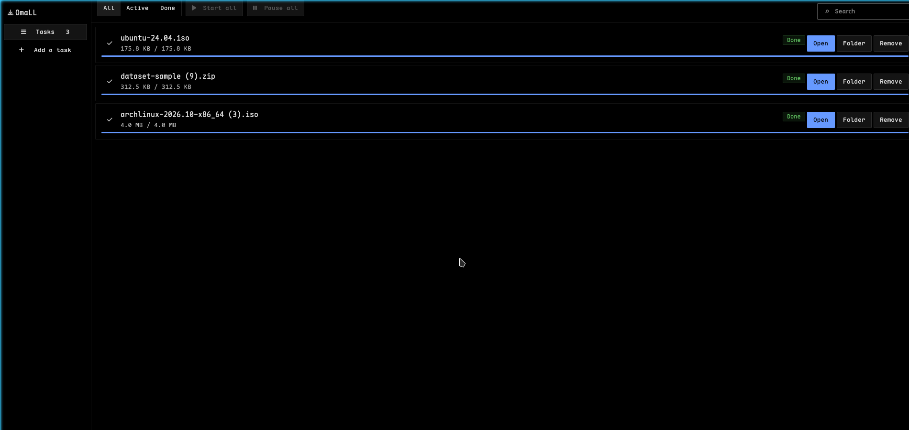
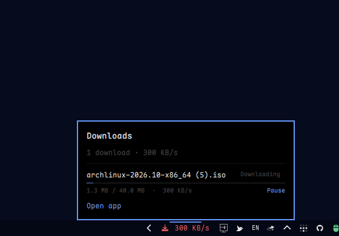
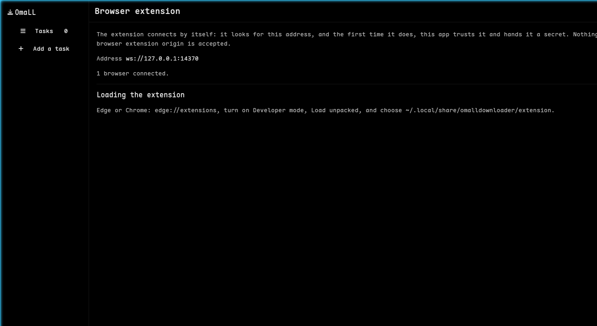

# OmaLLDownloader

[English](README.md) | **简体中文**

> **这是一个个人自用的 vibe-coding 项目。** 它只为我自己的桌面而写，绝大部分需求是用自然语言
> 描述后交给 AI 代理生成代码的；公开出来是因为也许对别人有用。它**不是生产级软件**：没有支持、
> 没有发布节奏、没有稳定性承诺，接口随时可能改。请预期有粗糙的地方。如果需要可靠的下载器，请用
> [aria2](https://aria2.github.io/)、[Motrix](https://motrix.app/) 或
> [Ghost Downloader](https://github.com/XiaoYouChR/Ghost-Downloader-3)。

一个带浏览器扩展的下载管理器，界面布局参照 Ghost Downloader，使用 ODK 的设计语言。
优先 Linux（目标是 Omarchy），macOS 可构建，Windows 仅在 CI 中构建
（见 [`docs/PLATFORMS.md`](docs/PLATFORMS.md)）。



窗口与 Ghost Downloader 相同：左侧栏（任务、新建任务、设置、浏览器扩展），工具栏有
全部 / 进行中 / 已完成、全部开始、全部暂停 和搜索框，每个下载一张卡片，显示名称、速度、
剩余时间、大小、进度条和自己的按钮。

```
crates/omad-core    类型定义与三项安全校验（URL、文件名、目标路径）
crates/omad-store   SQLite 任务记录，跨重启可续传
crates/omad-engine  分块 HTTP(S)，支持 Range、续传与摘要校验
crates/omad-rpc     浏览器扩展使用的本地桥（WebSocket + HTTP + 原生消息）
crates/omad-app     GPUI 窗口（ODK 组件、ODK 主题）
crates/omad-cli     `omalld` 命令行（也是原生消息宿主）
crates/omad-app-tests 窗口的测试，单独成 crate 以免 test-support 进入发布二进制
extension/          Chrome/Edge 扩展（Manifest V3，无打包器）
packaging/          Omarchy 桌面入口、图标、bar 插件与安装脚本
tools/              截图与计算机操作（CUA）工具
```

## 构建与运行

```sh
cargo run -p omad-app            # 打开窗口
cargo build -p omad-cli          # 产出 target/debug/omalld
cargo test --workspace           # 114 个测试，无需联网
```

命令行：

```sh
omalld probe https://example.com/big.iso        # 只看大小/名字/是否支持 Range，不下载
omalld add https://example.com/big.iso          # 立即下载
omalld add https://example.com/big.iso --name "My ISO"
omalld tasks                                    # 或 --json
omalld task tsk_3
omalld resume tsk_3
omalld wait tsk_3 --timeout 600
```

默认拒绝回环与内网地址，除非显式加 `--allow-private-network`。

## 在 Omarchy 上安装

```sh
packaging/install-omarchy.sh          # release 构建 + 安装 + 启用 bar 插件
packaging/install-omarchy.sh --debug  # 同上，用更快的 debug 构建
packaging/install-omarchy.sh --remove # 全部卸载
```

安装三部分，全部在 `$HOME` 下，不需要 root：

* **启动器入口** —— `~/.local/share/applications/omalldownloader.desktop` 与各尺寸图标；
* **可执行文件** —— `~/.local/bin/omalldownloader`、`~/.local/bin/omalld`；
* **bar 插件** —— `~/.config/omarchy/plugins/dimdoremy.omalldownloader/`，显示下载图标、
  运行中的任务数与合计速度，点开是每个任务的进度弹窗。它读 `omalld tasks --json`，
  所以 bar、窗口与命令行永远一致。

每个显示器有各自的 bar，因此各自有独立的 IPC 目标：

```sh
omarchy-shell dimdoremy.omalldownloader.HDMI-A-1 toggle   # 在该屏幕打开弹窗
```



## 浏览器扩展

```sh
cd extension
npm test          # 纯逻辑：地址规则、HMAC 证明、协议版本
npm run build     # 产出 extension/dist
npm run test:e2e  # 在真 Chromium 中通过 CDP 驱动扩展
```

在 Edge/Chrome 里 `edge://extensions` → **加载解压缩的扩展** → 选 `extension/dist`。
**不需要配对码**：扩展依次尝试浏览器的原生消息通道、`ws://127.0.0.1:14370`、
同端口的 `POST /rpc`；应用在首次连接时直接发放密钥，之后每次连接都用它证明身份。

`packaging/install-omarchy.sh` 会为找到的每个浏览器安装原生消息宿主清单。



## 下载行为

* 任务被接管时扩展会弹通知，弹窗里有实时下载列表；
* 同名文件自动加序号：`name (1).ext`、`name (2).ext`；
* 按扩展名自动分文件夹，规则在 `~/.config/omalldownloader/categories.json`
  （见 [`docs/CATEGORIES.md`](docs/CATEGORIES.md)）；
* 文件名优先用浏览器给的（`Content-Disposition`），其次 URL，最后问服务器；
* 会带上 `Referer` 与浏览器 UA——很多站点没有它们就返回 403；
* HEAD 或 Range 被拒时改用普通 GET，不支持分块也能单连接下载；
* 只有字节落盘、且服务器给了 sha-256 时校验通过，才算「已完成」。

## 支持的协议

HTTP/HTTPS（分块、可续传、摘要校验）、HLS、DASH、FTP、BitTorrent（通过
[librqbit](https://crates.io/crates/librqbit)）以及站点解析（通过 `yt-dlp`）已实现并有测试；
eD2k 委托给本地的 `amule`。细节与「为什么缺口在那里」见 [`docs/PROTOCOLS.md`](docs/PROTOCOLS.md)。

## 语言

窗口与命令行支持中文和英文。语言取自 `OMAD_LANG`（`en`/`zh`），否则看
`LC_ALL`/`LANG`，未知语言回退英文。所有文案集中在 `crates/omad-core/src/i18n.rs`，
漏翻译是编译错误而不是空白标签。

## 发布

带 tag 的 release 会附带 `OmaLLDownloader-x86_64.AppImage`（由
`packaging/make-appimage.sh` 构建，CI 也会跑）：

```sh
gh release download v1.0.0 -R DimDoremy/omalldownloader -p '*AppImage'
chmod +x OmaLLDownloader-x86_64.AppImage
./OmaLLDownloader-x86_64.AppImage        # 窗口；镜像里也含 omalld 与浏览器扩展
```

`extension/tests/e2e/appimage.test.mjs` 会启动这个 AppImage、用 CDP 加载扩展、从页面下载
一个文件，并校验 AppImage 写出的字节与服务器发出的完全一致。

## 安全边界

* 扩展、页面、命令行都不能给路径：任务只拿到一个目标名和一个经过清洗的文件名，
  应用在受控根目录内解析路径；
* 扩展首次连接时被信任并拿到密钥，之后每次连接都要证明；网页来源一律拒绝；
* 除非用户对该请求明确放开，否则不访问回环与内网地址；
* 字节没有真正落盘（且在服务器给出 sha-256 时校验通过）之前，不会标记为「完成」。

## 它不做什么

* 不内置 BitTorrent 之外的 P2P 协议（eD2k 委托给 `amule`）；
* 不做 Firefox 扩展（Manifest V3 无 `webRequest`，需要另一套下载拦截接口）；
* 没有自动更新、没有崩溃上报、没有多用户支持。

## 从 Ghost Downloader 迁移

`docs/REPLACING-GHOST-DOWNLOADER.md` 记录了本机如何卸载 Ghost Downloader 并把
MIME 关联、通知规则、扩展交给 OmaLLDownloader。

## 许可

MIT。Ghost Downloader 3 是 GPL v3：只研究了它的行为，没有复制它的代码。
